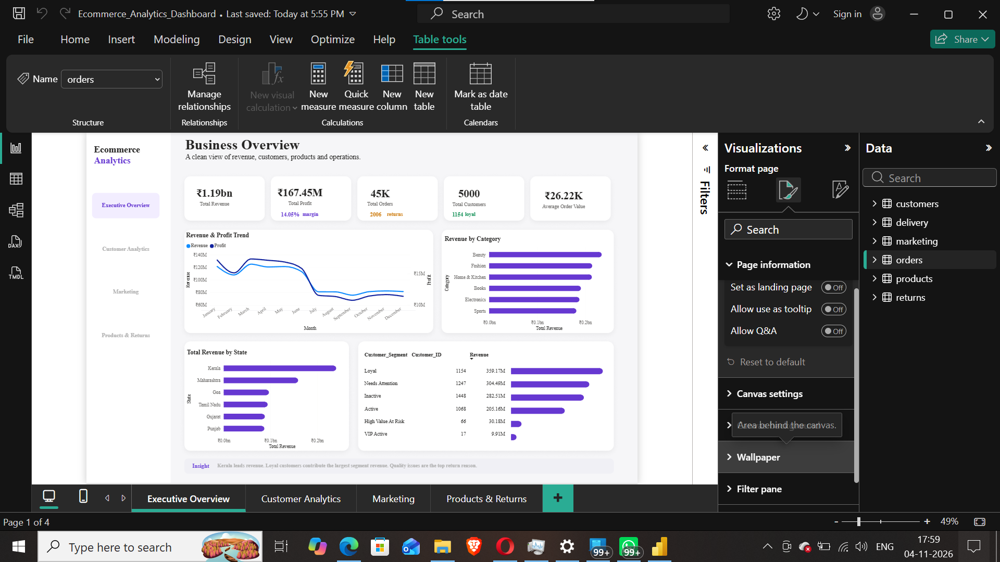
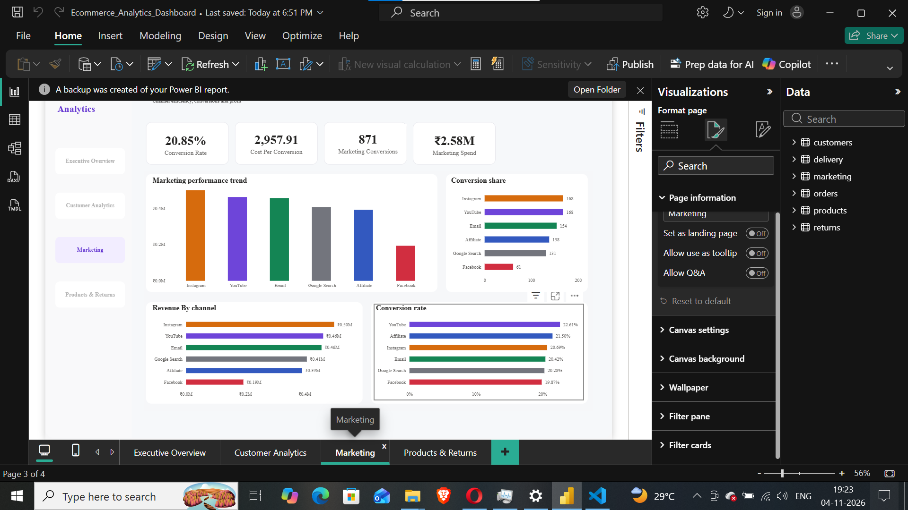
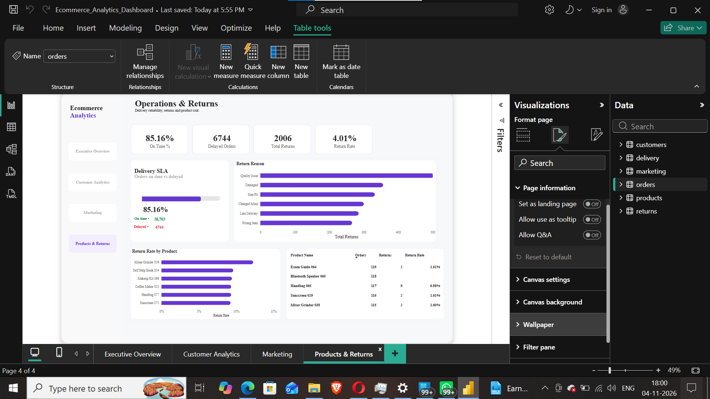

# 🛒 E-Commerce Sales Management Dashboard

## 📌 Project Overview

This project is an interactive E-Commerce Sales Management Dashboard developed using Microsoft Power BI.

The dashboard provides visual insights into e-commerce business data, helping analyze customer behavior, executive performance, marketing activities, and product returns.

## 🛠️ Technologies Used

- Microsoft Power BI
- Power Query
- DAX
- Data Visualization

## 📊 Dashboard Modules

### 1. Executive Overview


### 2. Customer Analytics


### 3. Marketing Analytics


### 4. Product Returns


## 📁 Project Structure

```text
Ecommerce-Sales-Management-PowerBI/
│
├── screenshots/
│   ├── customeranalytics.png
│   ├── executiveoverview.png
│   ├── marketing.png
│   └── productreturns.png
│
├── Ecommerce_Analytics_Dashboard (1).pbix
│
└── README.md
```

## 🚀 How to Use

1. Download the Power BI `.pbix` file from this repository.
2. Install Microsoft Power BI Desktop.
3. Open the downloaded file.
4. Explore the dashboard and its report pages.

## 👨‍💻 Author

**AHSAN KHAN**

GitHub: https://github.com/ahsankhan5620
